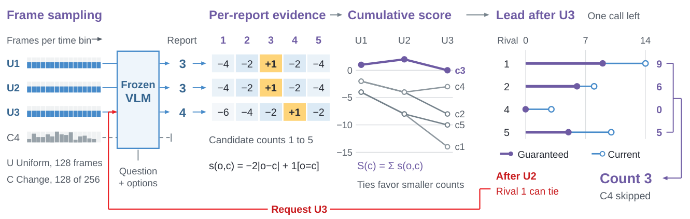

# Counting Actions in Long Videos by Aggregating Repeated Model Predictions

[Read the paper (PDF)](paper/manuscript.pdf) · [Reproduce the experiments](docs/reproduction.md) · [Browse the stopping rule](exact_stopping/replay.py)

When can a video model skip its next call without changing its final count? MAMC scores candidate counts using up to four model reports. After each report, it checks whether any allowed answer in the remaining slots could change the winner. If every possible completion gives the same count, it stops.

On the 60 official MLVU Action Count test videos, replaying this rule on the DeepSeek reports used **180 of 240 calls (25% fewer)** and recovered all 59 four-call counts and the one abstention.



## Try one video

For item `AC_8`, two reports of 3 still leave two possible final counts, 1 and 3. The third report, 4, settles the result. Run this example from the repository root using the recorded reports.

```python
from exact_stopping.replay import count_sequential

options = [1, 5, 4, 3, 6, 0]  # Counts the model can report for AC_8
reports = iter([3, 3, 4])
count, calls = count_sequential(options, reports, candidates=range(1, 6))
print(count, calls)  # 3 3
```

The fixed decoder scores counts 1 through 5 and breaks ties in favor of the smaller count. Use `candidates=options` to score the choices printed in the question. For inference, replace the iterator with a function that returns one count or `None` for the requested slot. The function is called only while another report can affect the result. [Algorithm and proof](exact_stopping/README.md)

## Official test results

These policies replay the same DeepSeek responses on all 60 test videos with the fixed decoder. Agreement counts an abstention as a match when both procedures abstain. Correctness uses the benchmark answer for every video.

| Policy | Calls | Decisions matching four calls | Correct counts |
| --- | ---: | ---: | ---: |
| All four calls | 240 | 60/60 | 33/60 |
| First three calls | 180 | 56/60 | 31/60 |
| Stop if the first three reports agree | 208 | 60/60 | 33/60 |
| Stop if the first two reports agree | 162 | 60/60 | 33/60 |
| **Exact stopping** | **180** | **60/60** | **33/60** |

Stopping on two equal reports happened to match all four-call decisions on this test. It changed three decisions on the 103 held-out development videos. Exact stopping preserved every four-call decision on that split using 292 of 412 calls. In the separate 16-frame greedy Qwen2-VL-2B test, one range-clipped first report already matched the four-call decision on every video. [Policy comparisons](stopping_comparison/README.md) · [Qwen test protocol](open_weight_test/README.md)

## Reproduce the results

From the repository root, use Python 3.11 or later. After installing dependencies, verification runs offline on CPU using the bundled records. It requires no video downloads, model weights, API calls or credentials.

```sh
python -m pip install -r requirements.txt
python -B verify_all.py
```

The verifier checks file hashes and replays the numerical experiments. A successful run ends with `All offline checks passed.` For a single study, use its replay command in the [reproduction guide](docs/reproduction.md).

Fresh API runs and video-input reconstruction use `requirements-inference.txt` and the commands in the reproduction guide. Open-weight inference uses Apple Silicon and MLX, with the original versions recorded in each study's `runtime.json`. The [data source guide](docs/data_sources.md) identifies the dataset and checkpoint revisions.

| Where to look | What it contains |
| --- | --- |
| [Exact stopping](exact_stopping/) and [policy comparisons](stopping_comparison/) | Sequential estimator, exhaustive checks, call budgets and token usage |
| [Official test records](external_eval/) and [development records](data/) | Per-question counts, model reports, sampling settings and source checksums |
| [Repeated requests](repeatability/), [fourth-call inputs](fourth_call/) and [sampling groups](seed_replication/) | Checks on identical requests, frame selection and report availability |
| [Published baselines](published_baselines/) | Reported MLVU Action Count scores with the original split, input protocol and publication table |
| [Editable figures](figures/README.md) | Data, drawing scripts and PowerPoint sources for all three manuscript figures |

Project code is distributed under the [MIT license](LICENSE). Dataset access, publication sources and third-party component licenses are listed in [third-party notices](THIRD_PARTY_NOTICES.md).
